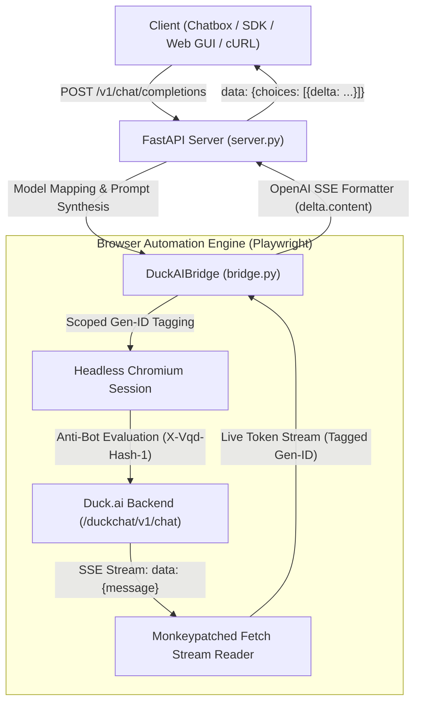

> 🦆 **duckai-api** · https://github.com/pavnxet/duckai-api

<div align="center">

# 🦆 DuckAI API Proxy & Web Chat GUI

**A high-performance, production-hardened OpenAI-compatible API proxy server and interactive Web GUI for Duck.ai (DuckDuckGo AI Chat).**

[](https://fastapi.tiangolo.com)
[](https://www.python.org/)
[](https://playwright.dev/)
[](https://www.docker.com/)
[](https://platform.openai.com/docs/api-reference)
[](LICENSE)

*Access GPT-6 Luna, Claude Haiku 4.5, Mistral Small 4, and open-source LLMs through a single standardized OpenAI-compatible interface with streaming SSE support, automated anti-bot evaluation, and zero API costs.*

[Features](#-key-features) • [Supported Models](#-supported-models) • [Quick Start](#-quick-start) • [Client Integrations](#-client-integrations) • [Architecture](#-architecture) • [Security & Hardening](#-security--reliability-hardening)

</div>

---

## 📖 Overview

**DuckAI API** bridges **DuckDuckGo's privacy-focused AI Chat (`duck.ai`)** to any OpenAI-compatible client, SDK, or framework. It solves DuckAI's browser anti-bot challenges (`X-Vqd-Hash-1`) headlessly in real time, intercepts outgoing Server-Sent Events (SSE), and streams them with sub-second latency.

Whether you want to connect **Chatbox**, **NextChat**, **Cherry Studio**, **Open WebUI**, **Cursor**, **LangChain**, or use the built-in dark-mode Web GUI, DuckAI API serves as an autonomous, self-healing local microservice.

---

## ✨ Key Features

- **Standard OpenAI API Specification**: Native drop-in support for `/v1/chat/completions` (streaming & non-streaming) and `/v1/models`.
- **Real-Time Token Streaming**: Low-latency Server-Sent Events (SSE) typewriter delivery.
- **Built-in Modern Web Chat GUI**: ChatGPT/Claude-style dark-mode interface with syntax highlighting, model switcher, and responsive mobile layout at `http://localhost:3006`.
- **Anti-Bot Challenge Bypass**: Automatically passes dynamic client challenges and browser fingerprint evaluations without visual captchas.
- **Cross-Request Token Isolation**: Generation-scoped token tagging (`window.__DUCKAI_CURRENT_GEN_ID__`) ensuring zero cross-request packet bleed.
- **Automated Memory Recycling**: Configurable background garbage collection and page refreshes preventing Chromium DOM/heap bloat during 24/7 uptime.
- **Client Disconnect Cancellation**: Aborting an HTTP stream automatically triggers DuckAI's `Stop generating` button, conserving compute and session state.
- **XSS-Hardened Frontend**: All markdown payloads sanitized through **DOMPurify** before rendering.
- **Optional API Key Authentication**: Protect your instance with `API_KEY` token authentication using constant-time `hmac.compare_digest`.

---

## 🤖 Supported Models

DuckAI API automatically maps standard OpenAI model names to Duck.ai models:

| Duck.ai Model | Aliases / Model IDs | Provider | Description |
|---|---|---|---|
| **GPT-6 Luna** | `gpt-6-luna`, `gpt-6`, `luna`, `default` | OpenAI | Flagship general-purpose model, high speed. |
| **Claude Haiku 4.5** | `claude-haiku-4.5`, `claude-3-5-haiku`, `claude` | Anthropic | Fast, concise reasoning and code analysis. |
| **GPT-5.4 mini** | `gpt-5.4-mini`, `gpt-4o-mini`, `gpt-4o` | OpenAI | Lightweight, efficient, and fast. |
| **Mistral Small 4** | `mistral-small-4`, `mistral` | Mistral AI | Multilingual European open-weights model. |
| **GPT-OSS 120B** | `gpt-oss-120b`, `oss-120b` | Tinfoil | Massive open-weights model. |
| **Gemma 4 31B** | `gemma-4-31b`, `gemma` | Google | Google Gemma 4 open model (Beta). |

---

## 🚀 Quick Start

### Option A: Local Python Setup

1. **Clone the repository:**
   ```bash
   git clone https://github.com/pavnxet/duckai-api.git
   cd duckai-api
   ```

2. **Install dependencies:**
   ```bash
   pip install -r requirements.txt
   playwright install chromium
   ```

3. **Start the server:**
   ```bash
   python server.py
   ```

The server will initialize the browser bridge and be ready on **`http://localhost:3006`**.
- **Web Chat GUI**: Visit [http://localhost:3006](http://localhost:3006)
- **Interactive Swagger Docs**: Visit [http://localhost:3006/docs](http://localhost:3006/docs)
- **Health Check**: `GET http://localhost:3006/health`

---

### Option B: Docker & Docker Compose

Deploy with a single command:

```bash
docker compose up -d --build
```

View live logs:
```bash
docker compose logs -f
```

---

## 🛠️ Client Integrations

### 1. Desktop AI Clients (Chatbox, Cherry Studio, NextChat)

Connect any desktop app by entering:
- **API Provider**: `OpenAI API`
- **API Base URL / Host**: `http://localhost:3006/v1` (or `http://localhost:3006`)
- **API Key**: Any dummy string (e.g. `sk-duckai-proxy`) or your configured `API_KEY`.
- **Model**: Select `gpt-6-luna`, `claude-haiku-4.5`, or `mistral-small-4`.

---

### 2. Python OpenAI SDK

```python
from openai import OpenAI

client = OpenAI(
    base_url="http://localhost:3006/v1",
    api_key="duckai"
)

# Streaming completion
response = client.chat.completions.create(
    model="claude-haiku-4.5",
    messages=[
        {"role": "system", "content": "You are a concise engineering assistant."},
        {"role": "user", "content": "Explain quantum computing in 20 words."}
    ],
    stream=True
)

for chunk in response:
    content = chunk.choices[0].delta.content or ""
    print(content, end="", flush=True)
```

---

### 3. LangChain

```python
from langchain_openai import ChatOpenAI

llm = ChatOpenAI(
    base_url="http://localhost:3006/v1",
    api_key="duckai",
    model="gpt-6-luna"
)

response = llm.invoke("What are 3 interesting facts about space?")
print(response.content)
```

---

### 4. cURL

```bash
curl -N -X POST http://localhost:3006/v1/chat/completions \
  -H "Content-Type: application/json" \
  -d '{
    "model": "gpt-6-luna",
    "messages": [{"role": "user", "content": "Hello DuckAI!"}],
    "stream": true
  }'
```

---

## 📐 Architecture



---

## 🛡️ Security & Reliability Hardening

The codebase was hardened through multiple rounds of adversarial audits:

- **Generation-Scoped Token Isolation**: Tokens emitted by DuckAI's browser fetch reader are tagged with `window.__DUCKAI_CURRENT_GEN_ID__`. If an old generation finishes late or is superseded, residual packets are immediately dropped, preventing cross-request token contamination.
- **DOMPurify Sanitization**: The bundled Web GUI at `static/index.html` passes all rendered markdown through DOMPurify, neutralizing all XSS and HTML injection vectors.
- **Deadlock-Free Lock Acquisition**: Uses `asyncio.timeout(30.0)` with a bounded acquisition guard, preventing lock leakage and head-of-line blocking under high concurrency.
- **Cancellation-Aware Browser Cleanup**: When an SSE client aborts connection mid-flight, Starlette's `CancelledError` triggers `stop_generation()`, halting background generation on DuckAI.
- **Automated Memory Recycling**: Automatically recycles the browser page every 100 requests or 24 hours, keeping RAM and DOM nodes clean for 24/7 self-hosting.
- **Constant-Time Authentication**: When `API_KEY` is configured, credentials are validated using `hmac.compare_digest` to prevent timing attacks.

---

## ⚙️ Configuration & Environment Variables

| Variable | Default | Description |
|---|---|---|
| `PORT` | `3006` | HTTP server port |
| `HOST` | `0.0.0.0` | Bind host address |
| `HEADLESS` | `true` | Set to `false` to show Chrome's visible window for debugging |
| `API_KEY` | *(None)* | Optional API token to require on all `/v1/*` requests |
| `RECYCLE_AFTER_REQUESTS` | `100` | Automatically recycle browser page after $N$ queries |
| `RECYCLE_INTERVAL_HOURS` | `24` | Maximum hours before recycling browser page |

---

## 📊 Health & Monitoring

Query the `/health` endpoint anytime for live uptime and bridge status:

```bash
curl http://localhost:3006/health
```

```json
{
  "status": "healthy",
  "service": "duckai-api",
  "bridge_ready": true,
  "auth_enabled": false,
  "models_count": 6,
  "requests_processed": 42,
  "max_requests_before_recycle": 100,
  "memory_recycling": true
}
```

---

## 📄 License & Disclaimer

This project is licensed under the **MIT License**.

> **Disclaimer**: This tool is an independent reverse-engineered API proxy created for educational, research, and personal interoperability purposes. It is not affiliated with, endorsed by, or associated with DuckDuckGo. Use responsibly and respect DuckDuckGo's terms of service.
